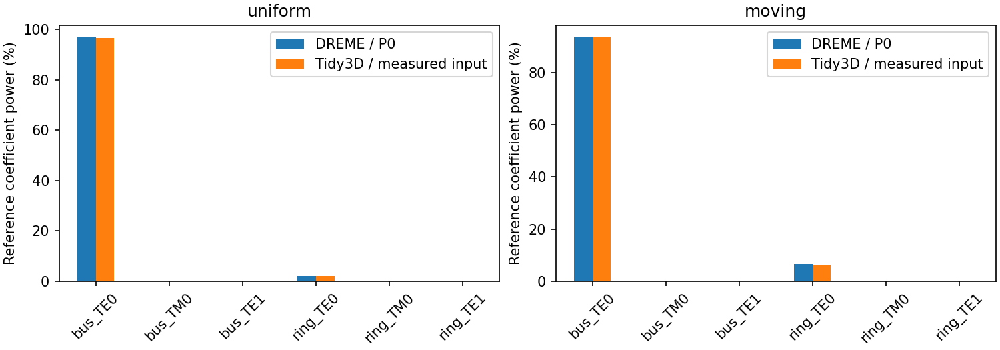

# Coupled-waveguide validation record

Commit 6 records mathematical checks and initial FDTD comparisons for the SOI example. The quantitative physical-accuracy criterion remains open. The core under test is commit 64ff141 on feat/coupled-waveguide. This record uses completed local Tidy3D files and starts no FDE or FDTD calculation.

The architecture and Commit 6 plan require uniform and moving-bus comparisons with matched excitation, geometry and reference planes, followed by checks selected from the observed discrepancies. The additional Lumerical FDTD run is pending separately.

- [Architecture agreement](https://app.notion.com/p/40e7160ba1e880aa85b6d80f31227607)
- [Commit 6 requirements](https://www.notion.so/40f7160ba1e880f6a069d7ba5c2196d9)

The dataset contains 33 gap nodes from 150 to 250 nm at 3.125 nm spacing, 24 coupled modes and three isolated references per guide. The 17-node dataset provides a gap-grid sensitivity check. The fully etched Si layer is 220 nm thick, with bus/ring widths of 500/450 nm, surrounded by oxide. Both endpoints have 250 nm gap. Propagation is global +x at 1550 nm. The uniform length is 10 um. The moving device approaches, holds and departs over 5 um each. Both solvers use the exact DREME staircase, fixed-axis widths and endpoint planes, transverse Metal/PEC walls and longitudinal absorbing boundaries. The two material indices match MODE at the comparison wavelength and are nondispersive in Tidy3D.

The input is the stored isolated bus TE0 E/H, with canonical channel ID (wg0, 1). Strongly coupled endpoint references overlap. Reported channel values are squared coefficients of 1 W isolated references under the same projection convention. Coherent totals use the full power Gram matrix. DREME values use requested input P0. Tidy3D values use the integrated forward input field. P1 and both denominators are retained in the CSV and manifest.

The following states apply to this snapshot.

| Check | Evidence and status |
| --- | --- |
| Implementation and synthetic regressions | 84 existing tests passed |
| Saved real-field mathematics | All 33 acquisition baselines rechecked |
| Reloaded endpoint E/H mathematics | Guided coupled subset and all six isolated fields checked |
| Basis changes | Permutation, complex phase and scaling preserve readout and power |
| Uniform complex propagation | Maximum canonical coefficient error against exact modal phase 1.56e-13 |
| FDTD initial comparison | Uniform and moving local results reprocessed |
| Quantitative accuracy acceptance | Open, with unresolved discretization and power discrepancies |
| Additional Lumerical comparison | Deferred while the existing CPU run continues |

All 33 saved acquisition records reproduce their directly integrated P0–P3 values within 7.11e-15 W. The largest residual-squared difference divided by direct-plus-reference norm is 1.65e-15. Reloaded endpoint power/E/H products differ from the saved products by at most 2.16e-14 after diagonal scaling. Basis changes preserve output coefficients within 2.25e-16 and powers within 2.67e-15 W. These are numerical consistency measurements. The raw endpoint export contains five guided coupled modes. Full 24-mode direct integrals at other nodes are checked against their acquisition records.

The two finest available comparisons give the following reference coefficient powers.

| Case | Channel | DREME / P0 (%) | Tidy3D / measured input (%) | Tidy3D minus DREME (pp) |
| --- | --- | --- | --- | --- |
| Uniform, 12.5 nm, 6 ps | bus TE0 | 96.864912 | 96.709634 | -0.155278 |
| Uniform, 12.5 nm, 6 ps | ring TE0 | 2.048126 | 2.061074 | +0.012949 |
| Moving, 12.5 nm, 12 ps | bus TE0 | 93.408365 | 93.440463 | +0.032097 |
| Moving, 12.5 nm, 12 ps | ring TE0 | 6.590146 | 6.351540 | -0.238606 |

All six output references, including small TM/TE1 terms, are in channel_comparison.csv. Small-channel errors are expressed as absolute percentage-point differences. The earlier tidy3d_c6_baseline results used a source shifted by 200 nm and are excluded from the acceptance comparison.

The first checks concern excitation and field readout. Corrected 12.5 nm results place the raw input Ey center within 0.46 nm of the intended 725 nm. Forward input E/H differs from isolated bus TE0 by about 2.397%/0.963% after common phase and power alignment. DREME's isolated-to-mapped input residual is 2.388%/0.950%. The integrated represented input is P1=0.999941305 W for P0=1 W. This residual alone cannot establish that the two actual guided excitations are identical.

A separate offline replay fits the measured Tidy3D forward input to the five saved guided MODE fields, scatters the coefficients through the actual runtime R, propagates with all 24 DREME modes and applies the original full-forward output map. The fitted input represents about 0.999565 W of the measured 0.999595 W. Its field-fit residual is about 0.840% E and 0.459% H. After power and phase alignment, its difference from the DREME mapped input is about 0.526% E and 0.411% H.

| Measured-input replay | Original Tidy3D minus DREME (pp) | Tidy3D minus replayed DREME (pp) |
| --- | --- | --- |
| Uniform bus TE0 | -0.155278 | -0.186793 |
| Uniform ring TE0 | +0.012949 | +0.048135 |
| Moving bus TE0 | +0.032097 | -0.139679 |
| Moving ring TE0 | -0.238606 | -0.109140 |

Excitation differences affect the moving-channel comparison. The replay retains only the represented guided input and provides a sensitivity diagnostic. A remaining difference persists after that adjustment.

Geometry and projection checks use the same section polygons and runtime node distances to generate the FDTD staircase. At 12.5 nm, reconstructed/native signed flux ratios are 0.999915/0.999981 at uniform input/output and 0.999964/0.999880 for moving. The isolated output Gram condition number is 1.84, with rank 6 and solve residual below 1e-16 in the selected cases. Output isolated-projection residuals are about 2.42%/0.86% E/H for uniform and 2.57%/0.97% for moving. Mode-to-field interpolation and finite reference expansion contribute to the measurement uncertainty.

The following sensitivities were measured from existing files. Mesh comparisons also change source interpolation, the Yee grid and modal projection sampling, so they measure their combined effect.

| Change | Case | bus TE0 change (pp) | ring TE0 change (pp) |
| --- | --- | --- | --- |
| Tidy3D time 3 to 6 ps, 20.27 nm mesh | Uniform | -0.000268 | -0.000131 |
| Tidy3D mesh 20.27 to 12.5 nm, 6 ps | Uniform | -0.633768 | +0.459941 |
| Tidy3D mesh 20.27 to 12.5 nm, 6 ps | Moving | -0.204776 | +0.712574 |
| Tidy3D time 6 to 12 ps, 12.5 nm mesh | Moving | +0.009429 | +0.000698 |
| DREME gap grid 17 to 33 nodes | Moving | -0.588217 | +0.009442 |
| DREME full-forward minus guided-only readout, same propagated vector | Moving | +0.161340 | -0.052573 |

The 6-to-12 ps ring change is much smaller than the remaining ring discrepancy. Mesh changes and DREME gap sampling remain significant. Two mesh values and two gap grids provide sensitivity measurements. An asymptotic error bound has not been established. The finest Tidy3D runs ended at their time limits with final field-decay values 2.01e-5 for uniform and 5.28e-4 for moving, above the configured 1e-5 shutoff threshold. Channel stability under the available time extension and total residual energy are recorded separately.

DREME's power checkpoints retain another unresolved issue.

| Case | P0 (W) | P1 (W) | P2 (W) | P3 (W) |
| --- | --- | --- | --- | --- |
| Uniform | 1.000000000 | 0.999941305 | 0.999969867 | 0.999924315 |
| Moving | 1.000000000 | 0.999941305 | 1.003983169 | 1.003902779 |

Moving has P2-P1=0.004041864 W, about 0.404% of the requested input. The direct-field/matrix checks validate the power accounting. They do not establish passivity of the truncated EME solution. No output renormalization, forced passivity or unitary fitting is used. The manifest records the stability policy, including PML sink settings. Discretization, retained modal basis and interface approximation remain candidates for further investigation. The existing observations do not identify a single cause or justify a physical acceptance tolerance.

Legacy coverage includes the normal single-guide compact input tests, a cached-data 1.0-to-1.2 um, 20 um Si taper and a 50 um effective-radius partial Euler SiN bend. Taper lumped and sectional propagation agree within 2.03e-8 in complex amplitude. The bend's 12 TE0/TE1-to-TE0/TE1/TE2+ powers, with interpolation enabled and disabled, are identical between pre-coupled commit 747810b and core commit 64ff141 in the same environment. Both versions differ from the archived CSV by at most 6.65e-5 in fractional power, or 0.00665 pp. That historical difference is retained in legacy_regression.json. The taper check exercises the cached-data entry points and supplies no separate physical-accuracy acceptance reference.

Reproduce the local audit with the existing env310 environment, Python 3.10.16, Tidy3D 2.12.0, NumPy 2.2.6 and SciPy 1.14.1. From the repository root run the following command, replacing the data root if the files have moved.

```powershell
& 'C:/Users/Jaesung/.conda/envs/env310/python.exe' -B -m examples.coupled_waveguide.audit_saved_results 'C:/Users/Jaesung/DREME/coupled_waveguide_runs' --output 'C:/Users/Jaesung/DREME/coupled_waveguide_runs/commit6_offline_audit'
```

The audit reads the six source-aligned case folders listed in audit_saved_results.py, verifies the stored simulation against the local HDF5, recomputes DREME, repeats the saved channel comparisons and writes new audit files. It also repeats the measured-input replay and real-field numerical checks. Original solver files remain in their data folders. The script rejects opening a MODE acquisition session during the audit. The notebook's section 5 calls the same function after section 0.

The existing regression suite was run from the repository root with the lumeric Python environment.

```powershell
& 'C:/Users/Jaesung/.conda/envs/lumeric/python.exe' -B -m unittest discover -s em_simulation -t .
```

All 84 tests passed. One synthetic inventory test emits its expected changed-guided-count warning. Offline package imports also print the existing Lumerical API-not-loaded diagnostic. No MODE acquisition is needed for these checks. The legacy bend comparison used the example's euler_profile, te_modes and group_powers helpers with the cached w_5um_curv_01000pm dataset in two fresh processes. legacy_regression.json records both code commits and all 12 values.

The committed artifacts contain small tables, diagnostics and a figure. run_manifest.json links the source file hashes, task IDs, dataset generations, basis IDs, solver settings and reference planes. Existing task metadata records a null server solver version, so its exact build is unavailable from these local records. The Tidy3D client version is recorded separately. Full E/H, FDE and FDTD files remain external.



Quantitative acceptance remains open pending a justified error budget for source representation, geometry discretization, modal projection and the EME power discrepancy. This snapshot records the completed implementation checks and available FDTD evidence with those limits.
